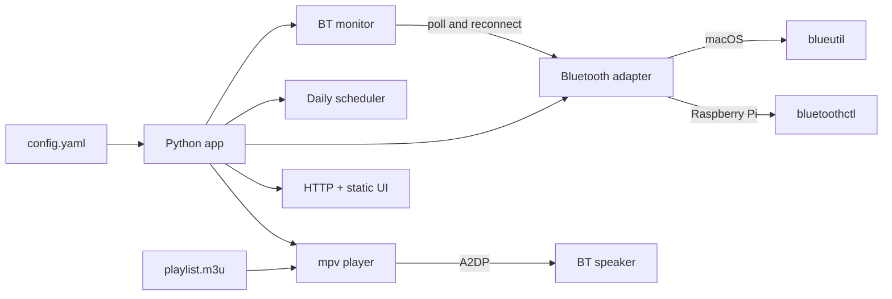

<!-- b4bd3118-2434-4997-892f-81b807815882 -->
---
todos:
  - id: "scaffold"
    content: "Scaffold package layout, requirements.txt, config/playlist examples"
    status: completed
  - id: "playlist-player"
    content: "Implement m3u parser and mpv player wrapper with IPC"
    status: completed
  - id: "bluetooth"
    content: "Implement macOS/Linux Bluetooth adapters plus auto-monitor and reconnect watchdog"
    status: completed
  - id: "scheduler"
    content: "Implement daily start/stop scheduler with overnight window support"
    status: completed
  - id: "web-api"
    content: "Flask API + plain HTML/CSS/JS UI with live-editable schedule and Bluetooth address"
    status: completed
  - id: "live-config"
    content: "Persist schedule/BT address to config.yaml and apply in-process without restart"
    status: completed
  - id: "deploy-docs"
    content: "Add systemd unit and README for Mac test + Pi production"
    status: completed
isProject: false
---
# Halloween Music Player

## Approach

Single Python process that owns scheduling, playback (via **mpv**), Bluetooth reconnect, and a small HTTP API + static web UI. Platform-specific Bluetooth is isolated behind adapters so Mac and Pi share the same app logic.



## Stack

- **Language:** Python 3 (existing `.venv`)
- **Playback:** `mpv` with JSON IPC (`--input-ipc-server`) for now-playing, play/stop, volume
- **Web:** `aiohttp` or stdlib `http.server` — prefer **Flask** (simple, sync-friendly) serving static files + JSON API
- **Config:** YAML (`config.yaml`) — start/stop times, playlist path, Bluetooth device address/name, web bind/port, default volume
- **UI:** plain HTML/CSS/JS only (no React/Vue/etc.), polling `/api/status` every few seconds

## Config (`config.yaml`)

```yaml
schedule:
  start: "17:00"   # local time, every day
  stop: "22:00"
playlist: "playlist.m3u"
bluetooth:
  device_address: "AA:BB:CC:DD:EE:FF"
  device_name: "Patio Speaker"   # display only
  poll_seconds: 15               # how often to check connection
  reconnect_backoff_seconds: 30  # wait after a failed reconnect before retry
audio:
  volume: 70                     # 0-100, mpv volume
web:
  host: "0.0.0.0"
  port: 8080
```

Overnight windows (e.g. `22:00`–`02:00`) will be supported: if `stop < start`, the window crosses midnight.

## Core modules

| Module | Responsibility |
|--------|----------------|
| [`main.py`](main.py) | Boot: load config, start scheduler + BT monitor + player + web |
| `config.py` | Load/validate YAML; thread-safe in-memory config; `save()` writes back to disk |
| `playlist.py` | Parse `.m3u` (skip comments/`#EXTINF`, resolve relative paths) |
| `player.py` | Wrap mpv subprocess + IPC: play playlist loop, stop, get title/path, set/get volume |
| `scheduler.py` | Background loop (~15–30s): reads live config for window; start/stop playback accordingly |
| `bluetooth/base.py` | Interface: `status()`, `connect()`, `disconnect()`; address comes from live config |
| `bluetooth/macos.py` | `blueutil --is-connected` / `--connect` / `--connected` |
| `bluetooth/linux.py` | `bluetoothctl info` / `connect` / `disconnect` |
| `bluetooth/monitor.py` | Background watchdog: poll link, auto-reconnect while schedule is active; uses current address |
| `web/` | Flask app + `static/index.html`, `app.css`, `app.js` |

Replace the PyCharm stub in [`main.py`](main.py).

## Playback behavior

- Inside schedule window: connect Bluetooth if needed, then `mpv --loop-playlist=inf` on the parsed track list (or pass the `.m3u` directly).
- Outside window: stop mpv cleanly.
- Current song from mpv IPC (`media-title` / `path`).
- Volume via mpv `set volume` (works the same on Mac and Pi once audio routes to the speaker).

## Bluetooth

- **macOS (dev):** `blueutil` using `device_address`. After connect, macOS usually switches output to the A2DP device; document optional `brew install switchaudio-osx` if auto-switch fails.
- **Raspberry Pi (prod):** `bluetoothctl connect <addr>` (device must already be paired/trusted once). Audio routes through PulseAudio or PipeWire to the Bluetooth sink; document one-time pairing steps in README.
- Auto-detect platform (`sys.platform`) and pick the adapter.
- Web UI “Reconnect” calls `POST /api/bluetooth/reconnect` (manual path; same `connect()` as the watchdog).

### Auto-monitor and reconnect

While the schedule window is active, a background **BT monitor** thread will:

1. Poll `is_connected()` every `bluetooth.poll_seconds` (default 15s).
2. If disconnected: call `connect()`, log the attempt, and surface status to the UI (`bluetooth.connected`, optional `bluetooth.last_error` / `reconnecting`).
3. On failed connect: wait `reconnect_backoff_seconds` before the next attempt (avoids hammering a powered-off speaker).
4. After a successful reconnect during active playback: leave mpv running when possible; if audio stalls, restart the playlist from the current loop (mpv keeps playing but may need a brief stop/start if the sink disappeared).
5. Outside the schedule window: stop auto-reconnect attempts (no need to keep the speaker linked overnight).

Manual UI reconnect always attempts immediately and resets the backoff timer.

## Web UI (plain HTML/CSS/JS)

Single page showing:

- Playing / stopped
- Current track title (filename fallback)
- **Editable** start and stop times (time inputs + Save)
- **Editable** Bluetooth device address (text input + Save)
- Volume slider → `POST /api/volume`
- Bluetooth connected/disconnected + **Reconnect** button

Poll `GET /api/status` every 2–3s. Halloween-appropriate styling without frameworks; keep layout simple (status panel, not a dashboard of cards).

### Live config edits (no restart)

- `POST /api/schedule` with `{ start, stop }` (validated `HH:MM`):
  1. Update in-memory config (thread-safe).
  2. Persist to `config.yaml` on disk.
  3. Scheduler immediately uses the new window on its next tick (and may start or stop playback right away if the “in window” state changed).
- `POST /api/bluetooth` with `{ device_address }` (and optional `device_name`):
  1. Update in-memory config and persist to `config.yaml`.
  2. BT adapter/monitor switches to the new address immediately.
  3. If currently inside the schedule window, attempt connect to the new device (and disconnect the old one when practical).
- Volume changes already apply live via mpv; also write `audio.volume` back to config so it survives restart.
- Shared `Config` object is the single source of truth for scheduler, monitor, and API — no file-watch/restart required.

### API

- `GET /api/status` → `{ playing, track, start, stop, volume, bluetooth: { connected, name, address, reconnecting, last_error } }`
- `POST /api/schedule` → `{ start, stop }`
- `POST /api/bluetooth` → `{ device_address, device_name? }`
- `POST /api/volume` → `{ volume: 0-100 }`
- `POST /api/bluetooth/reconnect`

No auth for v1 (LAN use); note that in README.

## Project layout

```
halloween-music/
  main.py
  config.yaml.example
  playlist.m3u.example
  requirements.txt
  README.md
  halloween_music/
    __init__.py
    config.py
    playlist.py
    player.py
    scheduler.py
    bluetooth/
      __init__.py
      base.py
      macos.py
      linux.py
      monitor.py
    web/
      app.py
      static/
        index.html
        app.css
        app.js
  deploy/
    halloween-music.service   # systemd unit for Pi
```

## Raspberry Pi production notes (README)

- Install: `mpv`, `bluez`, Python deps; pair/trust speaker once with `bluetoothctl`
- Enable systemd user/system unit from `deploy/halloween-music.service`
- Bind `0.0.0.0:8080` for LAN phone/laptop access

## Out of scope for v1

- Editing the playlist from the UI (still `.m3u` / config path only)
- Multi-speaker / AirPlay
- Auth / HTTPS
